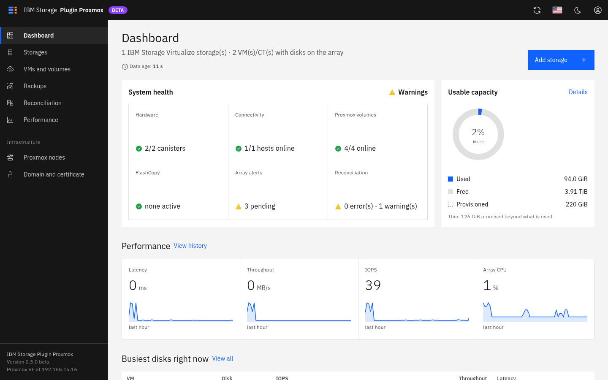
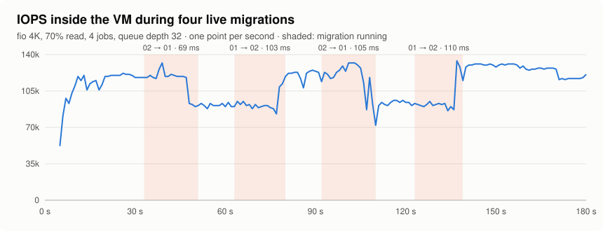
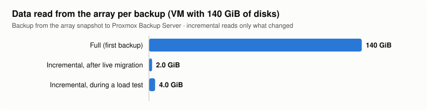
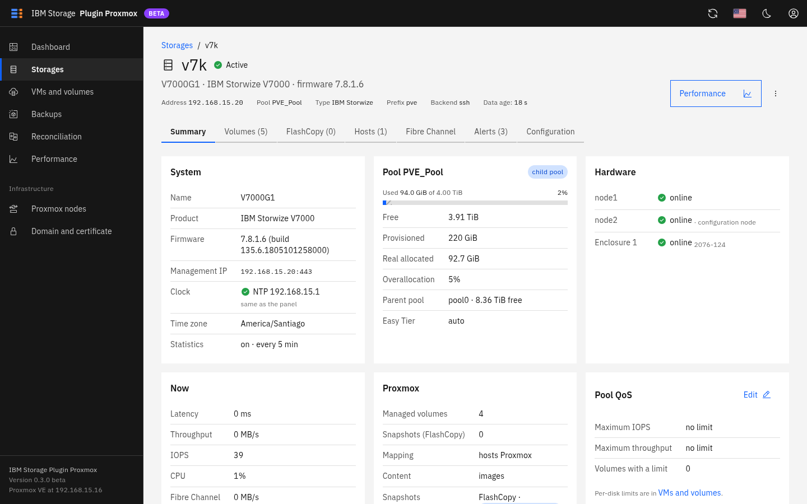
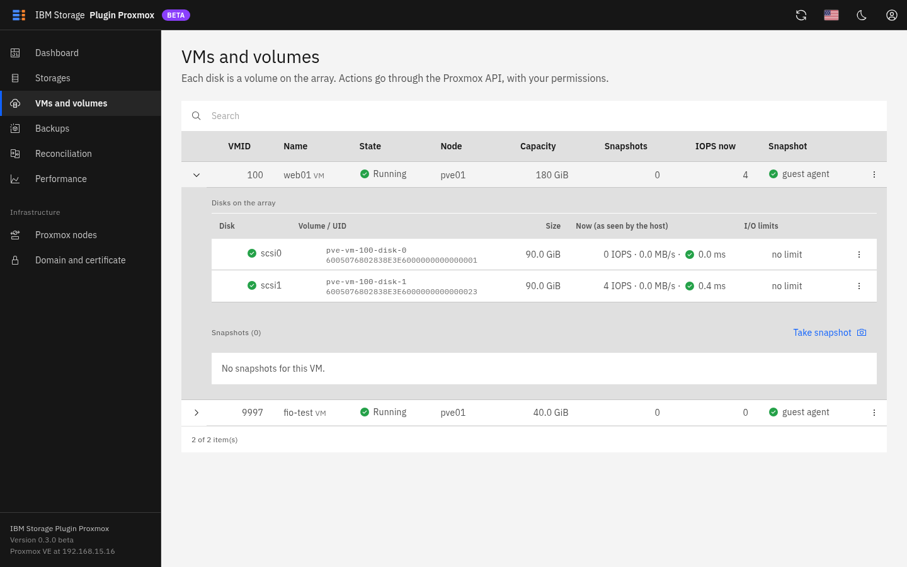
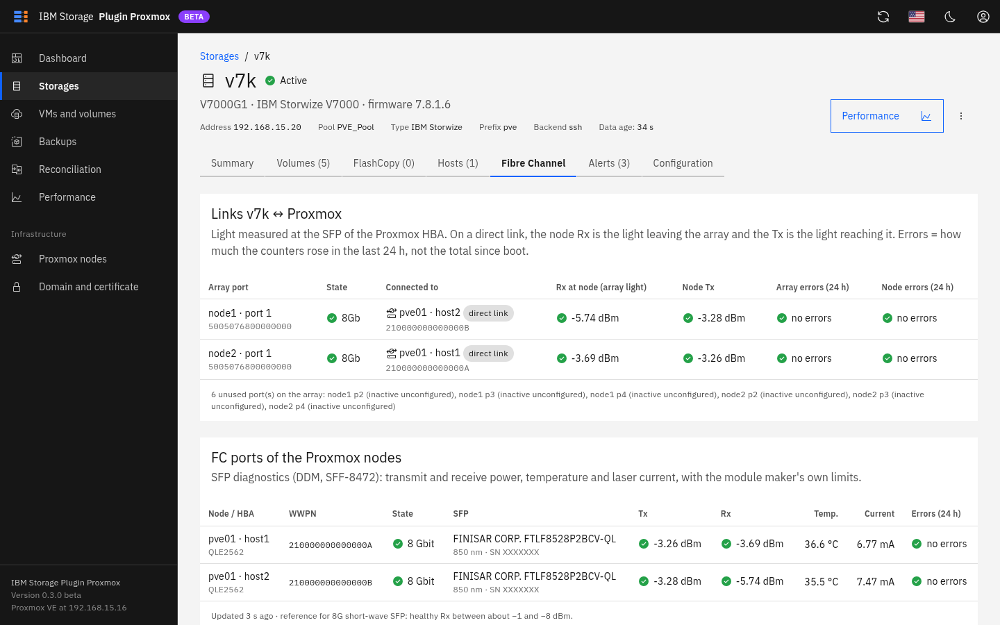
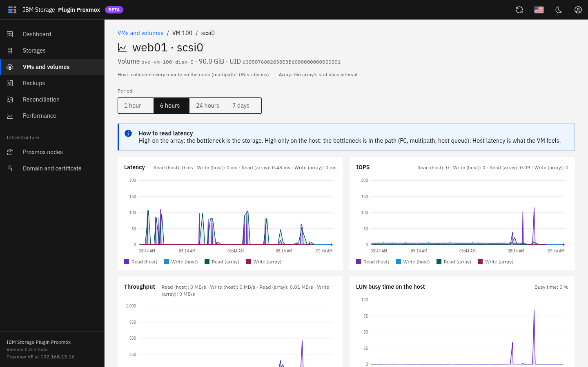
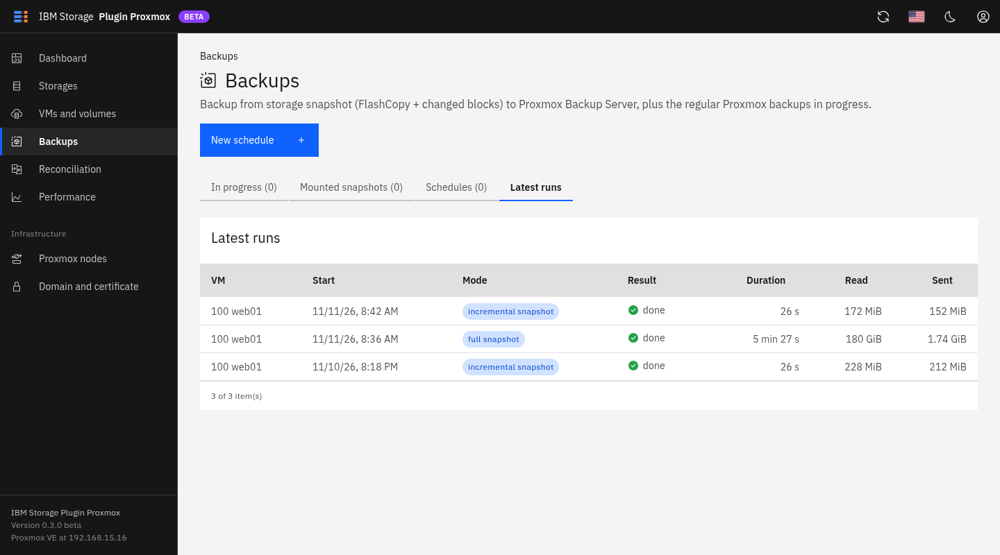
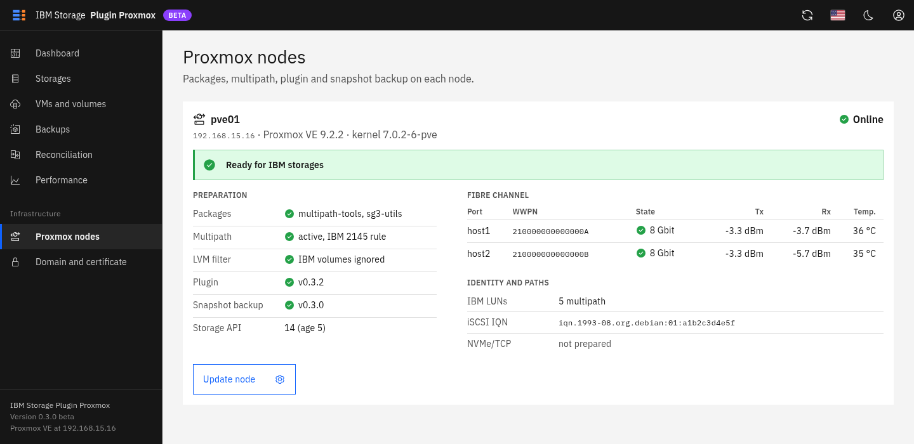

# IBM Storage Plugin Proxmox

A storage plugin and web panel that let **Proxmox VE** use **IBM Storage Virtualize** arrays
(Storwize, FlashSystem, SAN Volume Controller) as native block storage: one array volume per VM
disk, no LVM on the host, snapshots and QoS done by the array.

It has three parts:

- a **Proxmox storage plugin** (`storwize` and `flashsystem` storage types) that creates, maps,
  snapshots, resizes and removes volumes on the array;
- a **web panel** that runs in a small LXC container and talks only to the Proxmox API and to the
  array: storage registration, health, performance, QoS, backups, certificates;
- **snapshot-based backup** to Proxmox Backup Server: the array takes a FlashCopy snapshot, QEMU
  says which blocks changed, and only those blocks are read from the snapshot and sent to PBS.

> This is an independent project. It is not an IBM or Proxmox product and is not supported by
> either company. IBM, Storwize and FlashSystem are trademarks of IBM; Proxmox is a trademark of
> Proxmox Server Solutions GmbH. Use it at your own risk and test on a dedicated pool first.



## Download

| | |
|---|---|
| **Panel appliance** | [ibm-storage-plugin-proxmox-panel-0.3.3-beta.tar.zst](https://github.com/ghcoelhopsa/ibm-storage-proxmox-plugin/releases/download/v0.3.3-beta/ibm-storage-plugin-proxmox-panel-0.3.3-beta.tar.zst) (LXC container image, Debian 13, 174 MB). Restore it with `pct restore`; the panel then installs the plugin on the nodes. |
| **All releases** | [Releases page](https://github.com/ghcoelhopsa/ibm-storage-proxmox-plugin/releases), with the checksum of each image |
| **Source** | `git clone https://github.com/ghcoelhopsa/ibm-storage-proxmox-plugin.git` |
| **Runs on** | Proxmox VE 9.x (tested on 9.2, single node and two-node cluster) |
| **Arrays** | IBM Storage Virtualize 7.8 or later: Storwize, FlashSystem, SAN Volume Controller |

The steps are in [Quick start](#quick-start).

## Status

Beta. Validated on two labs:

| Lab | Array | Proxmox |
|---|---|---|
| 1 | Storwize V7000 Gen1, firmware 7.8.1.6, FlashCopy snapshots | VE 9.2, single node |
| 2 | FlashSystem 7600, firmware 9.1.2, volume group snapshots | VE 9.2, two-node cluster |

| Area | Validated |
|---|---|
| Disks: create, import, expand online, move, full clone, delete with trash | Labs 1 and 2 |
| Fibre Channel multipath (ALUA); path loss and return | Labs 1 and 2 (path loss: lab 2) |
| Snapshots, rollback and delete: FlashCopy consistency groups (7.8) and volume groups (8.5+/9.x) | Labs 1 and 2 |
| Live migration between nodes, including under load and with a Safeguarded policy | Lab 2 |
| Safeguarded snapshot policies: create, assign to VMs, restore over the VM or as a new VM | Lab 2 |
| New VM from a volume group snapshot: thinclone or clone | Lab 2 |
| Backup from the array snapshot to PBS: full, incremental, after migration, bandwidth limit | Labs 1 and 2 |
| Regular Proxmox backup and restore through PBS | Lab 2 |
| Web panel: inventory, performance and latency history, FC optical levels (QLogic and Emulex), node preparation, QoS | Labs 1 and 2 |
| Many operations at the same time (backups, snapshots, migrations, clones, moves) | Lab 2 |

Next to validate: disaster recovery with policy-based replication (needs a second array).

Measured numbers and charts: [docs/PERFORMANCE.md](docs/PERFORMANCE.md). Test log:
[docs/TEST-PLAN.md](docs/TEST-PLAN.md).

## Performance

FlashSystem 7600, 16 Gb FC, one VM with one virtual disk (details in
[docs/PERFORMANCE.md](docs/PERFORMANCE.md)):

| | |
|---|---|
| Random read / write 4K | 118,615 / 113,456 IOPS, about 1.1 ms |
| Sequential read / write 1M | 1,647 / 1,647 MB/s |
| Live migration | 69–110 ms downtime, I/O never stops |
| Snapshot of a running VM with 2 disks | 2.7 s |
| Backup from the array snapshot | full 140 GiB in 6 min 41 s; incremental reads only what changed |





## How it works

```
 Proxmox (pvedaemon/pvestatd) --> StorwizePlugin.pm --> command layer -+-> SSH  (svcinfo/svctask)    7.x, 8.x, 9.x
                                                                        +-> REST (:7443/rest/v1, JWT)  8.x, 9.x
 VM (QEMU) --> /dev/disk/by-id/dm-uuid-mpath-3<UID> --> dm-multipath --> FC/iSCSI --> array volume
```

- **One array volume is one VM disk**, raw, with no LVM or filesystem on the host. The node reaches
  the disk through multipath.
- **Management path.** The Storage Virtualize REST API accepts the same commands as the CLI, so the
  plugin has a single command layer with two transports. Features are enabled from the code level
  reported by `lssystem`.
- **Snapshots** are FlashCopy mappings with a thin target (`copyrate 0`), which work on every
  firmware. All disks of a VM go into one FlashCopy consistency group and are captured at the same
  instant. Rollback is a reverse FlashCopy with `-restore`; the data is usable immediately while
  the copy finishes in the background.
- **QoS.** IOPS and bandwidth limits per volume and per pool on the array (`mkthrottle`, 7.7+), or
  per disk in QEMU.
- **Several storages.** Each array or pool is one entry in `storage.cfg` with its own credentials
  and volume prefix. The plugin only touches volumes that carry its prefix.

The plugin started from the IBM white paper *"Integrate Proxmox Virtual Environment with IBM
Storage FlashSystem using a custom storage plug-in"*, which describes the architecture for REST on
FlashSystem 8.x. This project adds the SSH backend for arrays that cannot run 8.x, and everything
around it.

## Screenshots

| | |
|---|---|
|  |  |
| Storage summary: capacity, health, firmware features | VMs and their volumes, snapshots and limits |
|  |  |
| Fibre Channel links with SFP optical levels and error counters | Per-disk IOPS, throughput and latency |
|  |  |
| Snapshot-based backups: running jobs, schedules, history | Node preparation: packages, multipath, plugin |

## Requirements

- Proxmox VE 9.x (storage API 14). The plugin checks the API version when it loads.
- An IBM Storage Virtualize array reachable over SSH (any supported firmware) or REST (8.1.3+).
- A dedicated pool or child pool for Proxmox volumes, and a dedicated array user in the
  Administrator group. See [docs/V7000-SETUP.md](docs/V7000-SETUP.md).
- Host objects (or a host cluster) for the Proxmox nodes, created on the array. The panel shows
  them but does not create or change them.
- Fibre Channel or iSCSI connectivity between the nodes and the array, with `multipath-tools`.
- For the panel: an unprivileged Debian 13 LXC container with network access to the Proxmox API and
  to the array's management address.
- For snapshot-based backup: a Proxmox Backup Server storage configured in Proxmox.

## Quick start

### 1. Deploy the panel

**From the appliance image.** Download the container image from the
[releases page](https://github.com/ghcoelhopsa/ibm-storage-proxmox-plugin/releases) and restore it
on the Proxmox node:

```bash
wget https://github.com/ghcoelhopsa/ibm-storage-proxmox-plugin/releases/download/v0.3.3-beta/ibm-storage-plugin-proxmox-panel-0.3.3-beta.tar.zst
pct restore <ctid> ibm-storage-plugin-proxmox-panel-0.3.3-beta.tar.zst --storage <storage> --unprivileged 1 --unique 1
pct start <ctid>
pct console <ctid>      # shows the panel address and the installation code
```

The image is a Debian 13 container with the panel installed and nothing configured. It takes its
address from DHCP on `vmbr0` (change it with `pct set <ctid> --net0 ...`), creates its own
certificate and installation code on the first boot, and has the SSH server disabled; use
`pct enter <ctid>` for a shell.

**From the repository.** Create a Debian 13 container (512 MB of RAM is enough, with nesting
enabled, which Debian 13 needs in an unprivileged container), then run on the Proxmox node:

```bash
pct create <ctid> local:vztmpl/debian-13-standard_<version>_amd64.tar.zst --hostname ibm-storage-panel \
    --memory 512 --rootfs <storage>:4 --net0 name=eth0,bridge=vmbr0,ip=dhcp --unprivileged 1 --features nesting=1
pct start <ctid>
git clone https://github.com/ghcoelhopsa/ibm-storage-proxmox-plugin.git && cd ibm-storage-proxmox-plugin
./panel/deploy.sh <ctid>
```

The script installs the panel in the container and starts it on HTTPS port 443 with a self-signed
certificate. The first time you open `https://<container address>/` it asks for the Proxmox
address and shows the certificate fingerprint for you to confirm; the installation code it asks
for is printed on the container console (`pct console <ctid>`).

After that, sign in with a Proxmox user. Proxmox permissions apply: `Sys.Audit` on `/` to see the
panel, `Sys.Modify` on `/` to change anything.

### 2. Prepare the nodes

Open **Proxmox nodes**, authorise the panel on each node (the root password is used once to install
the panel's SSH key and is not stored) and run **Prepare node**. It installs `multipath-tools` and
`sg3-utils`, writes a multipath configuration for IBM 2145 devices, adds an LVM filter so the host
ignores LVM inside VM disks, and installs the plugin.

### 3. Add a storage

Open **Storages > Add storage**. The wizard asks for the array address and user, generates an SSH
key for you to register on that user, tests the connection, lets you pick the pool and the hosts
or host cluster, and registers the storage in Proxmox. The storage type is chosen from the model
the array reports: `flashsystem` for FlashSystem, `storwize` for Storwize and SVC.

From then on the storage behaves like any other in the Proxmox interface.

**Reinstalling or replacing the panel.** The array key of each storage is kept by Proxmox, not only
by the panel. A new panel takes it from there when you authorize a node (or when you open the
storage), so nothing changes on the array. Generate a new key only when the Proxmox key no longer
opens the array: from the moment it changes on the array until you click **Test and apply**, the
plugin cannot reach the array.

### Updating

From 0.3.5 on, the panel updates itself: **Updates** in the menu lists the newer releases with
their notes, and **Update to** replaces the panel code. The container, its configuration, the array
keys and the history stay. The package is signed and checked before it is installed; if the new
version does not start, the previous one comes back. Then use **Update node** on the
**Proxmox nodes** page to install the new plugin version on each node.

A panel on 0.3.4 or older updates once with `panel/deploy.sh <ctid>` from a clone of the
repository; after that, updates come through the panel. The container needs HTTPS access to
`api.github.com` and `github.com`.

### Installing the plugin without the panel

On every node:

```bash
apt install multipath-tools sg3-utils
cp examples/multipath.conf.example /etc/multipath.conf   # review the blacklist for your boot disk
systemctl enable --now multipathd
./scripts/install.sh

./scripts/setup-ssh-key.sh v7k 192.168.15.20     # creates the key and records the array host key
# register the public key on the array user, then:
pvesm add storwize v7k --sw-address 192.168.15.20 --sw-user pveplugin --sw-api ssh \
    --sw-pool PVE_Pool --sw-hosts Proxmox --content images --shared 1
```

With the REST backend the password is stored in `/etc/pve/priv/storwize/<id>.pw` and the TLS
fingerprint is pinned when the storage is added:

```bash
pvesm add flashsystem fs5200 --sw-address 10.0.0.50 --sw-user pveplugin --sw-api rest --password \
    --sw-pool Pool_SSD --sw-hostcluster pve-cluster --sw-prefix pvefs --content images --shared 1
```

## Storage options

| Option | Default | Description |
|---|---|---|
| `sw-address` | required, fixed | Management IP or host name |
| `sw-api` | `auto` | `ssh`, `rest` or `auto` (`rest` when a password is stored) |
| `sw-user` | required | Array user |
| `sw-sshkey` | `/etc/pve/priv/storwize/<id>_id_rsa` | SSH private key |
| `password` | none | REST password, stored outside `storage.cfg` |
| `sw-port` | 22 or 7443 | Management port |
| `sw-fingerprint` | pinned when added | SHA-256 of the REST certificate |
| `sw-pool` | required, fixed | Pool or child pool for the volumes |
| `sw-snappool` | `sw-pool` | Pool for FlashCopy targets |
| `sw-hostcluster` / `sw-hosts` | one of them | Where volumes are mapped |
| `sw-prefix` | `pve`, fixed | Prefix of every volume the plugin manages |
| `sw-iogrp` | `io_grp0` | I/O group |
| `sw-thin` | `1` | Thin-provisioned volumes |
| `sw-transport` | `auto` | `fc`, `iscsi`, `nvme-tcp` or `auto` |
| `sw-portals` | none | NVMe/TCP data ports of the array (`IP[:port]`, comma separated) |
| `sw-consistency` | `1` | Snapshot all disks of a guest at the same instant |
| `sw-trash-days` | `7` | Days a removed disk stays in the trash before it is deleted; `0` deletes at once |
| `sw-snapmode` | `flashcopy`, fixed | `flashcopy`, or `volumegroup` on 8.5.1+ (one volume group per guest) |
| `sw-volumegroup` | none | Volume group that new volumes join (8.3+) |
| `sw-partition` | none, fixed | Storage partition that owns the volumes and hosts (8.6.1+ / 9.x) |

## What the plugin does on the array

| Proxmox operation | Array commands |
|---|---|
| Create disk | `mkvdisk`, mapping to the hosts or host cluster |
| Remove disk | snapshots oldest first, local device, unmapping, then `chvdisk -name` into the trash (or `rmvdisk` with `sw-trash-days 0`) |
| Snapshot | thin `mkvdisk`, `mkfcmap`, consistency group, `startfcconsistgrp -prep` |
| Rollback | reverse FlashCopy with `-restore` |
| Remove snapshot | `stopfcmap`, wait, `rmfcmap`, `rmvdisk` |
| Resize | `expandvdisksize` and a local rescan; refused while the disk has snapshots |
| Reassign | `chvdisk -name` |
| Full clone, move disk, regular backup | done by QEMU; nothing happens on the array |

The `pve-ibm-storage` command lists what the plugin knows:

```bash
pve-ibm-storage list                # registered storages, state, firmware, capacity
pve-ibm-storage info v7k            # system, pool and supported features
pve-ibm-storage inventory           # guest <-> volume (UID, size, snapshots, local device)
pve-ibm-storage orphans             # volumes with the prefix that no guest uses
pve-ibm-storage stale-paths         # local multipath maps with no volume behind them
pve-ibm-storage trash               # removed disks still kept on the array
pve-ibm-storage --json inventory    # the same data as JSON
```

### Trash

Proxmox deletes every disk listed in a VM's configuration when the VM is destroyed, attached or
unused, whatever the options in the dialog. To give a way back, the plugin does not delete a
removed disk right away: it removes its snapshots, unmaps it from the hosts, and renames it
`<prefix>-trash<time>-<volume>` (for example `pve-trash1794431000-vm-9997-disk-0`). The disk
disappears from Proxmox but stays on the array for `sw-trash-days` (7 by default), then the plugin
deletes it during its hourly check. It keeps using space in the pool meanwhile.

The panel lists it under **Storage › Trash**, with **Restore** and **Delete now**. Restoring maps the
disk to the hosts again and adds it to the VM/CT as an unused disk; attach it under Hardware ›
Unused Disk. From the command line:

```bash
pve-ibm-storage trash v7k
pve-ibm-storage trash-restore v7k pve-trash1794431000-vm-9997-disk-0        # back to VM 9997
pve-ibm-storage trash-restore v7k pve-trash1794431000-vm-9997-disk-0 120    # or to VM 120
pve-ibm-storage trash-delete v7k pve-trash1794431000-vm-9997-disk-0
pvesm set v7k --sw-trash-days 14     # 0 turns the trash off
```

Disks in a volume group (8.x volume group snapshots, policy-based replication, storage partitions)
are still deleted at once. The trash does not replace backups: the snapshots of a removed disk are
not kept.

## The web panel

- **Dashboard**: system health, usable capacity, latency, throughput and IOPS, busiest disks.
- **Storages**: summary, volumes, FlashCopy mappings, hosts (read only), Fibre Channel links with
  SFP transmit and receive power and error counters, open alerts, configuration, and on recent
  firmware the Protection tab (volume groups, Safeguarded snapshots, replication).
- **VMs and volumes**: disks per guest, snapshots (create, roll back, delete), online resize,
  IOPS and bandwidth limits, per-disk performance history.
- **Backups**: jobs in progress, snapshots mounted by a running backup, schedules, recent runs.
- **Reconciliation**: differences between what Proxmox references and what exists on the array.
- **Performance**: array-level history.
- **Proxmox nodes**: preparation state of each node and its FC ports.
- **Domain and certificate**: self-signed certificate for a name, your own certificate, or Let's
  Encrypt (HTTP on port 80, or DNS through Cloudflare) with automatic renewal.

The interface is in English, Portuguese and Spanish, with light and dark themes.

More about deployment and files: [panel/README.md](panel/README.md).

## Snapshot-based backup

Regular Proxmox backup reads every disk through QEMU while the VM runs. This project adds a second
path for VMs on plugin storage:

1. QEMU keeps a dirty bitmap of the blocks written since the last backup. The bitmap moves with
   the VM in a live migration.
2. The array takes a snapshot of all the VM's disks at once: a FlashCopy consistency group (7.8) or
   a snapshot of the VM's volume group (`sw-snapmode volumegroup`, 8.5+/9.x). The guest agent
   freezes the filesystems for that moment. The VM is not paused.
3. The snapshot is mapped to the node running the backup only (a thinclone in volume group mode)
   and only the changed blocks are read from it and uploaded to Proxmox Backup Server, in the
   normal PBS format.
4. The snapshot is unmapped and removed.

The VM is locked (`lock: backup`) while the backup runs, as with vzdump, so it cannot be migrated
in the middle. The backup state lives in `/etc/pve`, so the next backup stays incremental on any
node. Upload speed follows the Proxmox backup bandwidth limit (`/etc/vzdump.conf`, datacenter or
storage `bwlimit`); on a 1 GbE network shared with corosync set one, for example
`pvesh set /cluster/options --bwlimit backup=61440` (60 MiB/s).

The result appears in Proxmox as a normal backup of the VM on that PBS storage and is restored the
usual way. If the snapshot path fails, the job falls back to the regular Proxmox backup.

Schedules are created on the **Backups** page. Each schedule becomes a systemd timer on the nodes,
so it runs even when the panel is down. Retention is whatever is configured in PBS.

A VM should be in a snapshot schedule or in a Proxmox backup job, not both, unless you want two
backups.

A backup, manual or scheduled, can be marked as **protected** on the PBS. Prune jobs and a plain
remove skip protected backups until someone clears the mark in Proxmox, so they keep using space.
The mark guards against mistakes; it is not immutability. Against an attacker, give Proxmox a PBS
token that can only write backups, pull the datastore from a second PBS, or keep the datastore on
an array volume with Safeguarded snapshots.

## Security

- No credentials in the code or in `storage.cfg`. The SSH key and REST password live in
  `/etc/pve/priv/storwize/` on the nodes and in `/var/lib/swpanel/` in the panel container.
- The plugin only creates, changes or removes volumes that carry its prefix, and only removes a
  FlashCopy whose target follows the `<prefix>-vm-N-..._s_<snapshot>` pattern.
- Every argument sent to the array is checked against `^[A-Za-z0-9_.:=*%/-]+$` and single-quoted.
- SSH uses strict host key checking with its own `known_hosts`; the REST certificate is pinned.
- The panel authenticates against Proxmox, keeps no passwords, pins the Proxmox certificate,
  rate-limits sign-in attempts and sends a restrictive Content-Security-Policy.
- The array user should be Administrator, never Security Administrator, so that Safeguarded
  snapshots cannot be removed through the panel.

## Limitations

- No templates or linked clones. Full clones work, also from a snapshot in volume group mode.
- With FlashCopy snapshots (7.8), resize is refused while the disk has snapshots.
- Snapshot policies run on the array clock: keep the array on NTP.
- Taking a Safeguarded policy off a volume group, or deleting a Safeguarded snapshot before it
  expires, needs the array Security Administrator role.
- Rollback needs the VM stopped, as always in Proxmox. The panel can start it again afterwards.
- Removing a volume cleans up the local device only on the node that ran the command; on other
  nodes use `scripts/cleanup-stale-paths.sh`.
- Disks of one VM on different storages are not in the same consistency group.
- Legacy arrays without UNMAP (such as the V7000 Gen1) do not reclaim space freed inside a VM.
- Proxmox file restore cannot open LVM inside a backup when two disks of the VM carry the same
  volume group identifiers (for example a cloned disk).

## Troubleshooting

| Symptom | Check |
|---|---|
| `device ... did not appear` | Zoning and mapping (`lshostvdiskmap`), `multipath -ll`, `systemctl status multipathd` |
| `Host key verification failed` | `scripts/setup-ssh-key.sh <id> <address>` |
| `CMMVC6035E` or name already in use | A volume with the same name created outside the plugin |
| Storage shown as inactive | `pve-ibm-storage list` shows the error; `journalctl -u pvestatd` |
| Full diagnostics | `scripts/collect-info.sh <id>` |

## Repository layout

```
src/PVE/Storage/Custom/   the storage plugin (StorwizePlugin.pm, FlashSystemPlugin.pm)
bin/pve-ibm-storage          inventory CLI
scripts/                  install, SSH key setup, smoke test, diagnostics
cbt/                      snapshot-based backup tools that run on the nodes
panel/                    web panel (FastAPI backend, static UI, deploy script, developer tools)
docs/                     array setup, test plan, 8.x/9.x and NVMe/TCP notes
examples/                 sample multipath.conf and storage.cfg
```

Names inside the code keep their history: the Proxmox storage types are `storwize` and
`flashsystem`, the options start with `sw-`, the CLI is `pve-ibm-storage` and the panel service is
`swpanel`.

## Documentation

- [docs/V7000-SETUP.md](docs/V7000-SETUP.md): preparing the array (user, key, pool, hosts)
- [docs/TEST-PLAN.md](docs/TEST-PLAN.md): test log
- [docs/PERFORMANCE.md](docs/PERFORMANCE.md): measured performance, with charts
- [docs/FS8X-SAFEGUARDED-DR.md](docs/FS8X-SAFEGUARDED-DR.md): Storage Virtualize 8.5.2+ and 9.1:
  Safeguarded snapshots, replication and DR, storage partitions
- [docs/NVME-TCP.md](docs/NVME-TCP.md): NVMe over TCP
- [panel/README.md](panel/README.md): the web panel
- [CHANGELOG.md](CHANGELOG.md)

## Roadmap

- Disaster recovery with policy-based replication between two arrays.
- NVMe over TCP: LVM filter, backup and statistics paths.
- Several child pools in one storage, with online volume moves between them.
- File-level recovery from array snapshots.
- Alerts by e-mail or webhook.

## License

GNU Affero General Public License, version 3 or later (AGPL-3.0-or-later), the same license as
Proxmox VE. See [LICENSE](LICENSE).

The panel ships IBM Carbon styles and icons, which are Apache-2.0; their license files are kept
next to them in `panel/static/`.
