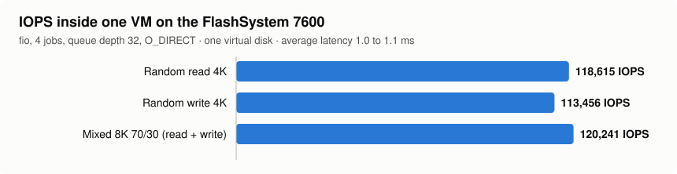
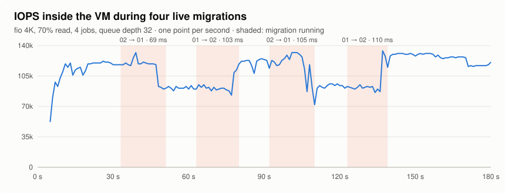
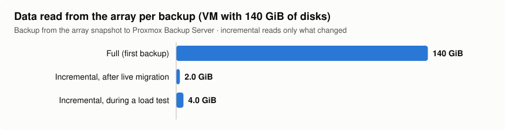
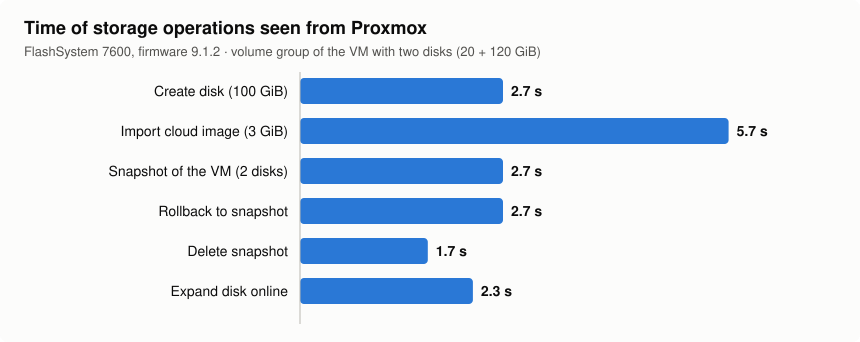

# Performance

Measured on 2026-11-13 with release 0.3.4-beta.

## Lab

| | |
|---|---|
| Array | IBM FlashSystem 7600, firmware 9.1.2.0, child pool `PVE_Pool` (50 TB, thick parent) |
| Nodes | 2 × Proxmox VE 9.2, kernel 7.0.2-6 (Xeon Bronze 3204 and Xeon Silver 4208) |
| SAN | Fibre Channel 16 Gb, direct attach, Emulex LPe31000, 2 paths per volume (ALUA) |
| Network | 1 GbE shared by management, VMs, migration and corosync |
| Backup | Proxmox Backup Server 4.2 (VM on the cluster, datastore on the array) |
| Test VM | Debian 13, 4 vCPU, `cpu: x86-64-v3`, disks with `iothread`, `aio=io_uring`, `cache=none` |
| Plugin | `sw-snapmode volumegroup`, host cluster mapping |

## I/O inside a VM

fio inside the guest, one virtual disk, `O_DIRECT`, `libaio`, 4 jobs, 40 s after a 5 s ramp.

| Test | Result | Average latency |
|---|---|---|
| Random read 4K, queue depth 32 | 118,615 IOPS (486 MB/s) | 1.07 ms |
| Random write 4K, queue depth 32 | 113,456 IOPS (465 MB/s) | 1.12 ms |
| Mixed 8K 70/30, queue depth 32 | 84,139 + 36,102 IOPS (689 + 296 MB/s) | 1.02 / 1.14 ms |
| Sequential read 1M, queue depth 16 | 1,647 MB/s | 40.7 ms |
| Sequential write 1M, queue depth 16 | 1,647 MB/s | 40.6 ms |

Sequential throughput matches one 16 Gb FC link: with ALUA each volume uses the optimized path to
its preferred node. More links spread several VMs over more ports.

## Live migration under load

Four live migrations between the two nodes with fio running in the VM (4K, 70 % read, 4 jobs,
queue depth 32, 180 s):

| Migration | Downtime | Lowest second |
|---|---|---|
| servidor02 → servidor01 | 69 ms | 90,275 IOPS |
| servidor01 → servidor02 | 103 ms | 83,137 IOPS |
| servidor02 → servidor01 | 105 ms | 71,926 IOPS |
| servidor01 → servidor02 | 110 ms | 86,196 IOPS |

I/O never stops; fio ends with zero errors. The two levels in the chart are the two nodes: the VM
runs at about 120–130 k IOPS on servidor01 and about 91 k on servidor02, with the same volume and
the same paths.

In a separate run, a fio job with data verification (`--verify=crc32c`) wrote and checked data for
14 minutes while the VM was migrated six times and backed up twice: no verification error.

## Backup

### From the array snapshot to PBS

The VM has two disks (20 + 120 GiB). The array takes a snapshot of the VM's volume group, a
thinclone of it is mapped to the node that runs the backup, and QEMU's dirty bitmap says which
blocks to read.

| Backup | Data read | Time | Notes |
|---|---|---|---|
| Full (first backup) | 140 GiB | 6 min 41 s | 370 MiB/s read; zero blocks are skipped |
| Incremental on the other node, after a live migration | 2.0 GiB | 1 min 24 s | limited to 30 MiB/s (`--bwlimit 30720`) |
| Incremental during a load test | 4.0 GiB | 48 s | fio writing, a clone and migrations running at the same time |

The filesystem freeze for the snapshot takes 1.9 to 2.6 s. The VM is not paused.

### Regular Proxmox backup

| Backup | Size | Time |
|---|---|---|
| vzdump to PBS, 20 GiB disk (94 % zeros) | 20 GiB | 23 s |
| vzdump to a directory on an array volume, zstd | 20 GiB → 379 MB | 23 s |
| Restore of that backup to the array, then boot | 20 GiB | 4 s for the data |

## Storage operations

| Operation | Time |
|---|---|
| Create a 100 GiB disk | 2.7 s |
| Import a 3 GiB cloud image into a new disk | 5.7 s |
| Snapshot of a running VM with 2 disks (volume group, with fs-freeze) | 2.7 s |
| Rollback | 2.7 s |
| Delete snapshot | 1.7 s |
| Expand a disk online (+20 GiB) | 2.3 s |
| Full clone of a running VM (140 GiB, QEMU mirror) | 1 min 30 s |
| Full clone from a snapshot (140 GiB, through a thinclone) | 3 min |
| New VM from a snapshot as a thinclone (panel) | immediate, 0.75 MB used on the array |
| Move a running disk FC → local-lvm → FC (20 GiB) | 40 s / 17 s |

## Concurrency

All of the following started together and ran for 14 minutes:

- fio with data verification in two VMs
- two incremental backups from the array snapshot (VM 9999)
- six live migrations (VM 9998, with a Safeguarded snapshot policy)
- a vzdump backup to PBS (VM 9993)
- five snapshot create/delete cycles (VM 9997)
- a full clone from a snapshot of the VM being backed up (VM 9999 → 9992)
- an online disk expansion (VM 9997)
- a new VM from a Safeguarded snapshot as a thinclone (VM 9998 → 9991)
- a live migration attempt of the VM being cloned (refused by the clone lock, as expected)

Every job finished; no I/O, multipath or plugin error on either node; no FlashCopy map or backup
snapshot left on the array. The temporary thinclone used by a clone from a snapshot is removed
together with the snapshot.

## Reproducing

- VM tests: `fio --filename=/dev/sdX --direct=1 --ioengine=libaio --numjobs=4 --group_reporting`
  with the block sizes and queue depths above.
- Backup: `python3 /usr/local/lib/ibm-storage-cbt/cbt_backup.py <vmid> <pbs-storage> [--full]
  [--bwlimit KiB/s]` prints a JSON report with the times and the amounts read and sent.
- Charts: `python3 docs/images/make_perf_charts.py [fio-iops-log migration-events]`.
